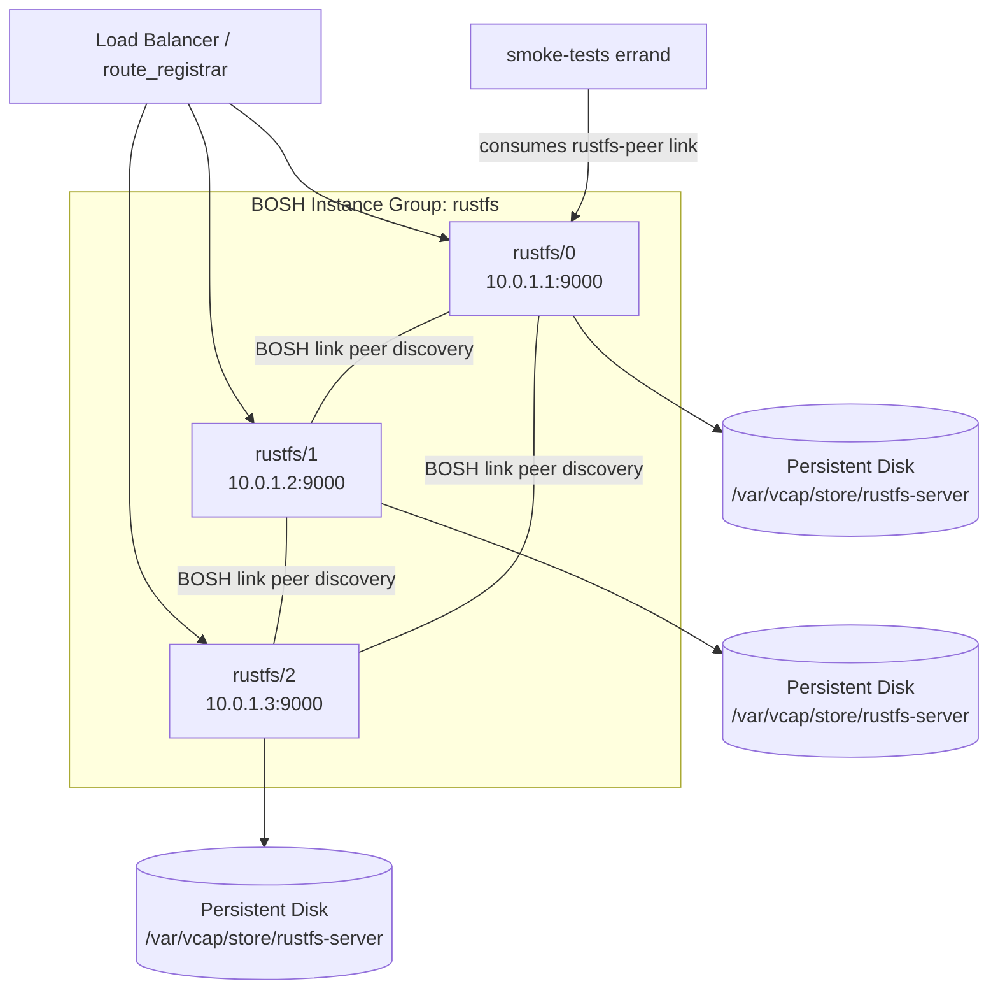

# rustfs-boshrelease

A BOSH release for [RustFS](https://github.com/rustfs/rustfs), an S3-compatible object storage server written in Rust.

## Overview

This release deploys RustFS 1.0.3, the first general-availability line of RustFS, and it discovers cluster peers through a BOSH link. It packages the pre-built, statically linked musl binary from the official RustFS GitHub releases, so the package needs no compiler and runs the same on every stemcell. A deployment can run as a single evaluation node with `manifests/ops/standalone.yml`, or as a multi-node distributed cluster. BPM manages the process lifecycle.

The release runs on Ubuntu Noble (24.04) and Ubuntu Resolute (26.04) stemcells. The default manifest targets Noble, and `manifests/ops/resolute.yml` moves it to Resolute.

Upstream lists distributed mode as available from 1.0 onwards. We still recommend testing node failure, restart, and rejoin against your own workload before you put important data on a cluster, and we recommend an external backup for single-node deployments, which have no redundancy at all.

## Features

- **S3-compatible API**

  The API listens on port 9000 and works with the AWS SDKs, mc, boto3, and s3cmd.

- **Web console**

  The console listens on port 9001 under `/rustfs/console/`, and it is enabled by default.

- **BOSH-link peer discovery**

  Cluster peers find each other through the `rustfs-peer` link, so no one writes a peer list by hand. The node count is fixed at the first deploy, though, because RustFS cannot grow or shrink a formed cluster in place.

- **BPM process management**

  The server runs as vcap with a persistent store, an ephemeral working directory, and a read-only root.

- **TLS**

  The API and the internode traffic share one certificate, and a CA lets cluster peers verify each other.

- **KMS integration**

  Server-side encryption can use a local key or a HashiCorp Vault or OpenBao backend.

- **Health endpoints**

  `/health`, `/health/ready`, and `/health/live` answer load balancers and probes.

- **Smoke-tests errand**

  The errand checks that every peer is ready and runs a full S3 object cycle after a deploy.

## Requirements

| Requirement | Minimum |
|-------------|---------|
| Stemcell | ubuntu-noble (24.04) or ubuntu-resolute (26.04) |
| BOSH director | v271 or later |
| bpm release | 1.4.22 on noble, 1.4.41 on resolute |
| Persistent disk per node | 50 GiB (recommended) |
| Ports open between nodes | 9000 (S3 API and internode RPC) |

The bpm pins matter. bpm 1.4.31 cannot start any process on a cgroup v2 stemcell such as Noble, and bpm releases older than 1.4.41 do not compile on Resolute. That is why `manifests/rustfs.yml` pins 1.4.22 and the resolute ops file pins 1.4.41, rather than either of them taking `latest`.

## Quick Start

If you use [Genesis](https://github.com/genesis-community), the [rustfs-genesis-kit](https://github.com/genesis-community/rustfs-genesis-kit) wraps this release with environment-aware defaults, credential generation, and `genesis do` addon support.

### Prerequisites

- A BOSH director with the bpm release available

- An Ubuntu Noble or Ubuntu Resolute stemcell uploaded

- A persistent disk type configured in the cloud-config

- Ports 9000 and 9001 open between cluster nodes

### Fetch blobs

Before you create a dev release, download and register the RustFS binary blob. The helper script verifies the download against upstream's published `SHA256SUMS` and refuses to register a binary it cannot verify.

```bash
scripts/add-blob.sh 1.0.3 musl
```

### Create a dev release

```bash
bosh create-release --force
bosh upload-release
```

### Deploy a three-node cluster

```bash
bosh deploy -d rustfs manifests/rustfs.yml \
  -v rustfs_access_key=myaccesskey \
  -v rustfs_secret_key=mysecretkey8chars
```

### Deploy a single node for evaluation

```bash
bosh deploy -d rustfs manifests/rustfs.yml \
  -o manifests/ops/standalone.yml \
  -v rustfs_access_key=myaccesskey \
  -v rustfs_secret_key=mysecretkey8chars
```

### Deploy on Resolute

Add the resolute ops file to either of the commands above. It switches the stemcell to ubuntu-resolute and pins bpm 1.4.41.

```bash
bosh deploy -d rustfs manifests/rustfs.yml \
  -o manifests/ops/resolute.yml \
  -v rustfs_access_key=myaccesskey \
  -v rustfs_secret_key=mysecretkey8chars
```

### Run smoke tests

```bash
bosh -d rustfs run-errand smoke-tests
```

## Properties

The following table covers the most commonly set properties. The `jobs/rustfs-server/spec` file has the full list with descriptions.

| Property | Default | Description |
|----------|---------|-------------|
| `rustfs.access_key` | required | Admin access key (RUSTFS_ACCESS_KEY). Min 3 chars. |
| `rustfs.secret_key` | required | Admin secret key (RUSTFS_SECRET_KEY). Min 8 chars. |
| `rustfs.port` | `9000` | S3 API and internode RPC port |
| `rustfs.console_port` | `9001` | Web console port |
| `rustfs.console_enable` | `true` | Enable the web console |
| `rustfs.log_level` | `info` | Log level: trace, debug, info, warn, error |
| `rustfs.persistent_disk_path` | `/var/vcap/store/rustfs-server` | Base path for data volumes |
| `rustfs.volumes_per_node` | `1` | Data sub-directories per node. Keep at 1, because a BOSH instance has one persistent disk. |
| `rustfs.unsafe_bypass_disk_check` | `false` | Skip the distinct-physical-disk validation (testing and CI only) |
| `rustfs.region` | `us-east-1` | S3 region the server reports (RUSTFS_REGION) |
| `rustfs.server_domains` | `""` | Comma-separated virtual-hosted-style domains |
| `rustfs.health_enable` | `true` | Enable the health endpoints |
| `rustfs.tls.certificate` | unset | API certificate. Set it together with `rustfs.tls.key` to serve https. |
| `rustfs.tls.key` | unset | API private key |
| `rustfs.tls.ca` | `""` | CA that signed the API certificate. A TLS cluster needs it. |
| `rustfs.kms.enable` | `false` | Enable server-side encryption |
| `rustfs.kms.backend` | `local` | KMS backend: local, vault, vault-kv2, vault-transit |

## TLS

When both `rustfs.tls.certificate` and `rustfs.tls.key` are set, pre-start installs them into `/var/vcap/data/rustfs-server/tls` and the job points `RUSTFS_TLS_PATH` at that directory. RustFS then serves https only, and plaintext requests to port 9000 are refused. Pre-start rebuilds the directory on every start, so it holds exactly what the current deploy rendered. Template rendering fails when only one half of the key pair is set, so a typo cannot quietly turn TLS off.

A TLS cluster needs two more things, because RustFS serves internode RPC on the same TLS port and peers verify each other's certificates. First, set `rustfs.tls.ca` to the CA that signed the API certificate, so that every peer trusts it. Template rendering fails for a multi-node TLS deployment without one. Second, every peer's API certificate must name that peer's IP address as a subject alternative name, because the peer URLs the job builds from the `rustfs-peer` link use IP addresses. A certificate that names only a DNS alias fails the TLS handshake between peers, and the cluster never reaches quorum. Set `features.use_dns_addresses: false` in the deployment manifest, as `manifests/rustfs.yml` does, so that the link carries IP addresses rather than BOSH DNS names.

The post-start and drain scripts verify every node against the same CA, and they dial each node by its link address, never with `curl -k`. A single node dials itself at 127.0.0.1, so its certificate must name 127.0.0.1 when `rustfs.tls.ca` is set. A single TLS node without a CA is probed without verification, because there is nothing to verify against.

The `rustfs.peer.tls.*` properties are still accepted, but RustFS does not read the files they render. Peer trust comes from `rustfs.tls.ca`.

## Cluster Mode Notes

When `instances > 1`, the `rustfs-server` job uses the BOSH `rustfs-peer` link to collect every peer's IP address and builds `RUSTFS_VOLUMES` with one URL per peer per data sub-directory. The URLs use `https` when TLS is enabled and `http` otherwise, and IPv6 addresses are bracketed. When any address is IPv6, the server listens on `[::]` instead of `0.0.0.0`. The manifest sets `update.serial: true` and `max_in_flight: 1` so that nodes start one at a time, which initial cluster formation needs.

A cluster needs at least three nodes. With two, losing either node loses quorum, so a two-node cluster gives no more availability than a single node and doubles the ways it can fail.

### Node count is fixed

RustFS fixes the shape of its erasure set when a cluster first forms, and it refuses to change it in place. Growing a single node into a cluster fails, and the node logs this line in `/var/vcap/sys/log/rustfs-server/rustfs-server.stderr.log`:

```text
unsupported pool expansion ... single-node single-drive (SNSD) ... cannot be expanded in place
```

BOSH reports only that the canary is not running, after the watch time runs out. Adding or removing nodes in a formed cluster fails the same way, because the remaining nodes hold a format for the old drive count. To change the node count, copy the data out through the S3 API, delete the deployment, deploy fresh with the new count, and copy the data back.

### Rolling updates, post-start, and drain

Post-start first waits for `/health`, which shows that the process is up. It then asks the other peers for `/health/ready`. When at least one of them is ready, the cluster is formed and this node is rejoining it, so post-start waits up to `rustfs.post_start.ready_timeout_secs` (300 by default) for this node to become ready, and fails the start when it does not. When no other peer is ready, this is a fresh deploy or a cold start after a full outage. A new cluster is not ready until every node is up, and BOSH starts the next node only after post-start passes, so in that case post-start passes on liveness alone.

The drain script holds a node up until every other peer answers `/health/ready`, so that BOSH never stops a second node while the first is still rejoining. It is a dynamic drain, which means it returns a negative number and BOSH calls it again a few seconds later. It gives up after `rustfs.drain.timeout_secs` (600 by default), logs that to `/var/vcap/sys/log/rustfs-server/drain.log`, and lets the stop go ahead, so that drain can never hang a deploy. It returns at once on a single node, and also when the node itself is not ready, because then there is no quorum left to protect.

Stopping or deleting a whole cluster therefore takes longer than it used to. The first node stops at once, the next waits out the drain bound because the first is gone, and the last stops at once because quorum is already lost. Pass `--skip-drain` to `bosh stop` or `bosh delete-deployment` when you mean to take the whole cluster down. The sample manifest allows ten minutes of watch time per node to cover both waits.

Keep `volumes_per_node` at its default of `1`. RustFS validates that local erasure endpoints live on distinct physical disks, and a BOSH instance has exactly one persistent disk, so several data sub-directories on the same disk fail at startup with `local erasure endpoints must use distinct physical disks`. Erasure coding spans nodes instead, so use three or more instances for an erasure-coded cluster. For local testing only, `rustfs.unsafe_bypass_disk_check: true` skips the validation.

**Single-node mode** (`manifests/ops/standalone.yml`) sets `instances: 1` and `volumes_per_node: 1`. In this mode there is no erasure coding and no data redundancy, so keep an external backup.

## Architecture



## Packages

| Package | Contents |
|---------|---------|
| `rustfs` | Pre-built RustFS binary (linux-x86_64-musl, 1.0.3) |

The packaging script needs `unzip` on the compilation VM, and both the Noble and the Resolute stemcells ship it. The script checks for it first and fails with a clear message when it is missing. It also runs the installed binary's `--version` so that a damaged blob fails at compile time rather than at deploy time.

## Smoke Tests

The `smoke-tests` errand performs these steps:

1. It sends HTTP GET `/health/ready` to every cluster peer, and each one must return 200.

2. It runs S3 `CreateBucket` on the first peer.

3. It runs S3 `PutObject` to write a test payload.

4. It runs S3 `GetObject` and checks that the content matches.

5. It runs S3 `DeleteObject` to remove the object.

6. It runs S3 `HeadObject` and expects a 404, which confirms the deletion.

7. It runs S3 `DeleteBucket` to clean up.

The errand signs every request with AWS Signature Version 4. It builds the HMAC chain in bash, hashes with `openssl` on stdin, hex-encodes with `od`, and sends the request with `curl`, so it needs nothing beyond the base tools that the Noble and Resolute stemcells ship. Neither the secret key nor any derived signing key appears on a command line. Every `x-amz-*` header it sends is signed, because RustFS 1.0 rejects requests that carry unsigned ones.

When the API uses TLS, set `rustfs.tls.certificate` and `rustfs.tls.ca` on the errand too. It then probes over `https` and verifies every node against the CA by its link address. Without the CA, it skips verification with `-k` and prints a warning.

Run the errand after every deploy.

```bash
bosh -d rustfs run-errand smoke-tests
```

## Release Process

The [release process guide](docs/RELEASE.md) covers cutting a final release, and [CONTRIBUTING.md](CONTRIBUTING.md) covers blob management and dev releases.

## Contributing

See [CONTRIBUTING.md](CONTRIBUTING.md) for the development workflow.

## License

Apache 2.0. See [LICENSE](LICENSE).

RustFS itself is also licensed under the Apache 2.0 License.
